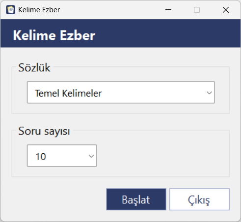
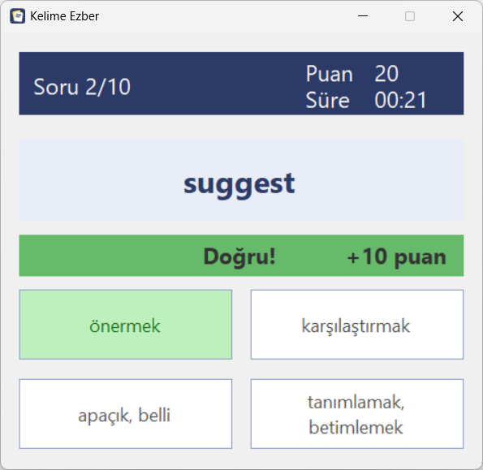
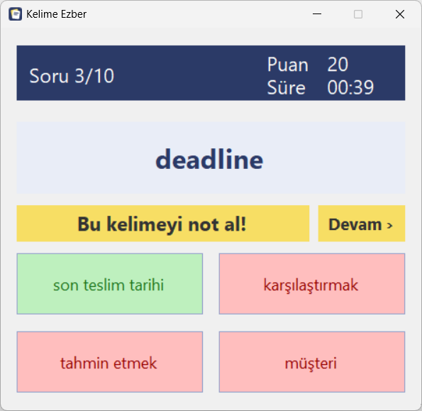
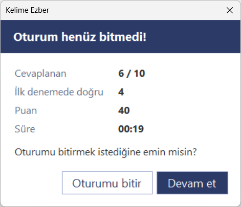
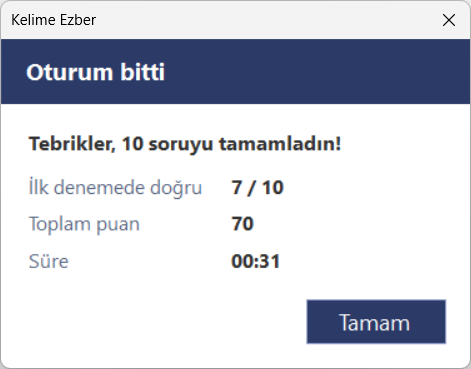

# Kelime Ezber

C# ve Windows Forms ile yazılmış, çoktan seçmeli sorularla İngilizce kelime ezberlemeye yarayan bir masaüstü uygulaması.

Sakarya Üniversitesi Bilgisayar Mühendisliği, Nesneye Dayalı Programlama dersi (2024-2025 Bahar) ödevi olarak geliştirdim. Teslimden sonra kenar durumlarda çıkan hataları düzelttim, oyun mantığını formlardan ayırdım; soru sayısı seçimi ve süre sayacı ekleyip arayüzü yeniden tasarladım.

<table>
  <tr>
    <td align="center"><br>Sözlük ve soru sayısı seçimi</td>
    <td align="center"><br>Soru ekranı</td>
  </tr>
  <tr>
    <td align="center"><br>İlk denemede doğru cevap</td>
    <td align="center"><br>Bilinemeyen kelimede doğru cevap gösterilir</td>
  </tr>
  <tr>
    <td align="center"><br>Oturum yarıda kapatılırken onay</td>
    <td align="center"><br>Oturum sonu</td>
  </tr>
</table>

## Özellikler

- Program klasöründeki tüm `.txt` sözlük dosyalarını otomatik olarak listeler
- Her oturumda sorulacak kelime sayısı seçilebilir: 10, 20, 30 ya da tümü
- Kelimeler her oturumda rastgele sırayla sorulur, yanlış şıklar sözlüğün tamamından seçilir
- Her soruda 1 doğru ve 3 yanlış şık gösterilir
- Yanlış seçilen şık kırmızıya döner ve tekrar seçilemez; tüm yanlışlar elenirse doğru cevap gösterilir ve Devam butonuyla sonraki kelimeye geçilir
- Sadece ilk denemede doğru bilinen kelimeler 10 puan kazandırır
- Süre sayacı sadece soru cevap beklerken işler, pencere arka plana alınınca durur
- Oturum yarıda kapatılmak istenirse o ana kadarki sonuçlarla birlikte onay istenir
- Oturum sonunda ilk denemede bilinen kelime sayısı, toplam puan ve süre gösterilir
- Klavyeyle kullanılabilir: ana ekranda Enter oturumu başlatır, Esc programı kapatır
- Boş, hatalı ya da çok küçük sözlük dosyalarında uyarı verir

## Kurulum

Gereksinimler: Windows, Visual Studio 2019/2022 (.NET masaüstü geliştirme iş yükü), .NET Framework 4.8

```bash
git clone https://github.com/iremmguzel/KelimeEzber
```

`KelimeEzber.sln` dosyasını Visual Studio ile açıp **F5** ile çalıştırın. `Sozlukler/` klasöründeki dosyalar derleme sırasında otomatik olarak `.exe` dosyasının yanına kopyalanır.

## Sözlük formatı

Her satırda bir kelime ve anlamı bulunur, aralarında tab karakteri olmalıdır. Dosya UTF-8 olarak kaydedilmelidir.

```
computer	bilgisayar
keyboard	klavye
mobile phone	cep telefonu
```

Dosyanın ilk satırına `#` ile başlayan bir başlık yazılırsa listede sözlüğün adı olarak bu başlık görünür. Böylece dosya adında Türkçe karakter ve boşluk kullanmaya gerek kalmaz:

```
# Yazılım Terimleri
algorithm	algoritma
```

Yeni bir sözlük eklemek için `.txt` dosyasını `Sozlukler/` klasörüne koyup projeyi yeniden derlemek yeterli. Dosya adları küçük harf, Türkçe karaktersiz ve boşluksuz verilmeli (ör. `yazilim_terimleri.txt`). Başlık satırı yoksa ad dosya adından üretilir (`temel_kelimeler` → `Temel Kelimeler`). Soru oluşturabilmek için sözlükte en az 4 farklı anlam bulunmalıdır.

## Proje yapısı

| Dosya | Görevi |
|---|---|
| `Kelime.cs` | Kelime ve anlamını tutan model sınıfı |
| `Sozluk.cs` | Sözlüğün listede görünen adını ve dosya yolunu tutar |
| `SozlukYonetici.cs` | Sözlük dosyalarını listeleme ve okuma |
| `EzberOturumu.cs` | Soru seçimi ve sırası, şık üretimi ve puan hesabı |
| `SoruSayisiSecenegi.cs` | Sözlüğün kelime sayısına göre soru sayısı seçeneklerini üretir |
| `FormAna.cs` | Sözlük ve soru sayısı seçme ekranı |
| `FormSoru.cs` | Çoktan seçmeli soru ekranı |
| `FormOzet.cs` | Oturum sonu ve oturumu bitirme onayı pencereleri |
| `DuzButon.cs` | Ana ekran butonlarında kullanılan düz stilli buton |

Oturum mantığı `EzberOturumu` sınıfında toplandığı için formlar sadece ekranı güncelliyor. Bu sayede mantık arayüzden bağımsız olarak değiştirilebilir ve test edilebilir.
