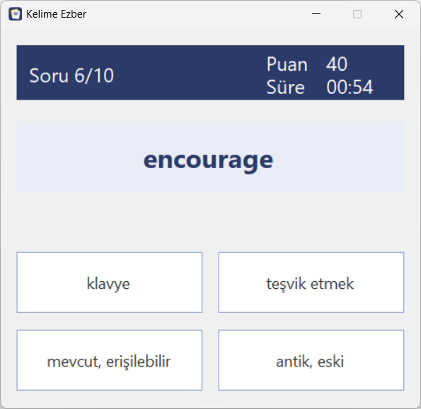

# Kelime Ezber

C# ve Windows Forms ile yazılmış, çoktan seçmeli sorularla İngilizce kelime ezberlemeye yarayan bir masaüstü uygulaması.

Sakarya Üniversitesi Bilgisayar Mühendisliği, Nesneye Dayalı Programlama dersi (2024-2025 Bahar) ödevi olarak geliştirdim. Teslimden sonra kenar durumlarda çıkan hataları düzelttim ve oyun mantığını formlardan ayırdım.

<!-- Ekran görüntülerini docs/ klasörüne ekleyip aşağıdaki satırları açabilirsin -->
<!--  -->
<!--  -->

## Özellikler

- Program klasöründeki tüm `.txt` sözlük dosyalarını otomatik olarak listeler
- Her oturumda kelimeler rastgele sırayla sorulur
- Her soruda 1 doğru ve 3 rastgele yanlış şık gösterilir
- Yanlış seçilen şık kırmızıya döner, doğru cevap bulunana kadar sonraki soruya geçilmez
- Sadece ilk denemede doğru bilinen kelimeler 10 puan kazandırır
- Oturum sonunda ilk denemede bilinen kelime sayısı ve toplam puan gösterilir
- Boş, hatalı ya da çok küçük sözlük dosyalarında uyarı verir

## Kurulum

Gereksinimler: Windows, Visual Studio 2019/2022 (.NET masaüstü geliştirme iş yükü), .NET Framework 4.8

```bash
git clone https://github.com/iremmguzel/KelimeEzber
```

`KelimeEzber.sln` dosyasını Visual Studio ile açıp **F5** ile çalıştırın. `Sozlukler/` klasöründeki dosyalar derleme sırasında otomatik olarak `.exe` dosyasının yanına kopyalanır.

## Sözlük formatı

Her satırda bir kelime ve anlamı bulunur, aralarında tab karakteri olmalıdır. Dosya UTF-8 olarak kaydedilmelidir.

```
computer	bilgisayar
keyboard	klavye
mobile phone	cep telefonu
```

Dosyanın ilk satırına `#` ile başlayan bir başlık yazılırsa listede sözlüğün adı olarak bu başlık görünür. Böylece dosya adında Türkçe karakter ve boşluk kullanmaya gerek kalmaz:

```
# Yazılım Terimleri
algorithm	algoritma
```

Yeni bir sözlük eklemek için `.txt` dosyasını `Sozlukler/` klasörüne koyup projeyi yeniden derlemek yeterli. Dosya adları küçük harf, Türkçe karaktersiz ve boşluksuz verilmeli (ör. `yazilim_terimleri.txt`). Başlık satırı yoksa ad dosya adından üretilir (`temel_kelimeler` → `Temel Kelimeler`). Soru oluşturabilmek için sözlükte en az 4 farklı anlam bulunmalıdır.

## Proje yapısı

| Dosya | Görevi |
|---|---|
| `Kelime.cs` | Kelime ve anlamını tutan model sınıfı |
| `SozlukYonetici.cs` | Sözlük dosyalarını listeleme ve okuma |
| `EzberOturumu.cs` | Soru sırası, şık üretimi ve puan hesabı |
| `FormAna.cs` | Sözlük seçme ve yükleme ekranı |
| `FormSoru.cs` | Çoktan seçmeli soru ekranı |

Oturum mantığı `EzberOturumu` sınıfında toplandığı için formlar sadece ekranı güncelliyor. Bu sayede mantık arayüzden bağımsız olarak test edilebilir.

## Geliştirilebilecekler

- Yanlış bilinen kelimelerin oturum sonunda tekrar sorulması
- Türkçeden İngilizceye soru modu
- Oturum geçmişinin kaydedilmesi
